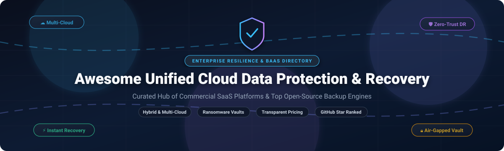

  

# Awesome Unified Cloud Data Protection & Recovery 🛡️☁️

  
  
  

> 🌐 A curated directory of top Unified Cloud Data Protection, Backup-as-a-Service (BaaS), and Disaster Recovery (DRaaS) solutions — comparing enterprise SaaS platforms and top-starred open-source tools with transparent pricing, trial terms, company scale, and architecture benchmarks.

Centralized data resilience across hybrid cloud, multi-cloud (AWS, Azure, GCP), virtual machines (VMware, Hyper-V, Proxmox), containers (Kubernetes), databases, and SaaS workloads (Microsoft 365, Google Workspace, Salesforce).

---

## 📈 Sector Overview & Market Dynamics 📊

The global Cloud Data Protection, Backup-as-a-Service (BaaS), and Disaster Recovery-as-a-Service (DRaaS) sector is valued between **$8 billion and $11 billion**, projected to exceed **$45 billion to $100+ billion by the early 2030s** at a rapid **22%–32% CAGR** driven by escalating ransomware attacks, strict compliance mandates (DORA, NIS2, HIPAA, GDPR), and widespread hybrid multi-cloud migrations. The market is **moderately fragmented yet increasingly consolidating** through mega-mergers (such as Cohesity acquiring Veritas’s enterprise data protection unit), balancing established enterprise incumbents against high-growth cloud-native resilience specialists rather than following a winner-take-all dynamic. 🚀

---

## 📋 Table of Contents 📑

- [📈 Sector Overview & Market Dynamics](#-sector-overview--market-dynamics-)
- [🟦 SaaS / Hosted Platforms](#-saas--hosted-platforms-)
- [🟩 Open-Source Software](#-open-source-software-)
- [📊 Comparison Matrix](#-comparison-matrix-)
- [⭐ Star History](#-star-history-)
- [💖 Support & Sponsorship](#-support--sponsorship-)
- [🤝 Contributing](#-contributing-)
- [📄 License](#-license-)

---

## 🟦 SaaS / Hosted Platforms 🏢

Enterprise-grade, cloud-native and managed Backup-as-a-Service (BaaS) & Disaster Recovery platforms. Sorted in descending order by company scale (revenue / market valuation). 💼

| Platform 🛠️ | Company Scale (Revenue / Valuation) 💰 | Starting Tier Pricing 🏷️ | Free Tier / Trial Limits ⏳ | Key Architecture & Best For 🎯 |
|:---|:---|:---|:---|:---|
| **[Dell PowerProtect](https://www.dell.com/en-us/dt/data-protection/powerprotect-software.htm)** | **$95.6B Rev / ~$75B-$80B Market Cap** | **$125.00/TB/month** (PowerProtect Backup Service entry tier on cloud marketplace) | **90-Day Free Evaluation** (PowerProtect Data Manager virtual edition with full features) | Disruption-free VM snapshots, native Dell storage direct replication, Kubernetes container protection, and multicloud data protection. |
| **[Veeam Data Platform](https://www.veeam.com/)** | **$1.7B+ ARR / $15.0B Valuation** | **$155.00/workload/year** (~$12.92/workload/month for Foundation tier) | **Free Forever Community Edition** (up to 10 workloads/instances at zero cost) or **30-Day Free Trial** with full enterprise features | Comprehensive cyber-resilience with AI-powered malware detection, automated recovery verification, and physical/virtual/cloud workload coverage. |
| **[Rubrik Security Cloud](https://www.rubrik.com/)** | **$856M+ ARR / ~$8.5B Market Cap** | **$58.00/TB/month** (~$700/TB/year baseline capacity subscription commit) | **30-Day Guided Proof-of-Concept (PoC)** / Virtual Lab Trial via sales sandbox | Zero-Trust data resilience engine with immutable backups, sensitive data discovery, automated threat hunting, and ransomware recovery orchestration. |
| **[Cohesity DataCloud](https://www.cohesity.com/)** | **$1.6B+ Pro-Forma ARR / $7.0B Valuation** | **$150.00/TB/year** (~$12.50/TB/month baseline front-end storage subscription) | **30-Day Free Trial** (up to 5TB managed front-end capacity and 30 workloads) | Cyber-resilient scale-out architecture featuring zero-trust immutability, cyber-vaulting (FortKnox), and unified data management. |
| **[Datto SaaS Protection](https://www.datto.com/products/saas-protection/)** | **$689M ARR / $6.2B Acquired by Kaseya** | **$2.00/user/month** (Standard 12-month retention M365/Google Workspace tier) | **14-Day Free Trial** (up to 50 user seats with automated daily snapshots) | Infinite cloud retention, point-in-time restores, MSP multi-tenant portal, and seamless compliance archiving for M365 and Google Workspace. |
| **[Veritas Alta](https://www.veritas.com/alta)** | **$1.0B+ Div. ARR / $7.0B Merged with Cohesity** | **$80.00/TB/year** (~$6.67/TB/month for cloud data management capacity tier) | **60-Day Free Trial** (Veritas Alta SaaS Protection with full M365 connector support) | Enterprise hybrid cloud resilience, automated anomaly detection, non-disruptive DR rehearsals, and regulatory compliance archiving. |
| **[Commvault Cloud](https://www.commvault.com/)** | **$1.18B Rev / ~$7.0B Market Cap** | **$58.50/TB/month** (or ~$2.75/user/month for SaaS M365 workload protection) | **30-Day Free Trial** (unlimited access to Commvault Cloud SaaS backup modules) | AI-powered Threat Scan, synthetic multi-point clean recovery, autonomous cyber-recovery, and cross-cloud mobility. |
| **[Acronis Cyber Protect Cloud](https://www.acronis.com/)** | **$550M+ Rev / $3.5B Valuation** | **$85.00/workstation/year** (~$7.08/workstation/month or ₹1,800/workload/month) | **30-Day Free Trial** (full feature access for up to 5 endpoints and 1TB cloud storage) | Unified integration of endpoint cybersecurity, AI-powered anti-malware, vulnerability patching, backup, and rapid disaster recovery for MSPs. |
| **[Druva Data Resiliency Cloud](https://www.druva.com/)** | **$200M+ ARR / $2.0B Valuation** | **$2.50/user/month** (Endpoint/SaaS tier) or **$30.00/TB-month** (Enterprise infrastructure credit) | **30-Day Free Trial** (no credit card required, up to 100 users or 1TB cloud storage) | 100% serverless SaaS data protection with air-gapped immutable AWS cloud vaults, deduplication, and zero infrastructure overhead. |
| **[Arcserve UDP](https://www.arcserve.com/)** | **~$100M Rev / ~$600M Private Equity Valuation** | **$125.00/TB/month** (Cloud Direct) or **$750.00 one-time** (perpetual base agent license) | **30-Day Free Trial** (full capabilities for Arcserve UDP Software & SaaS Backup) | Hardware VSS snapshot offload, built-in global deduplication, continuous data protection (CDP), and purpose-built backup appliances. |
| **[HYCU Protégé](https://www.hycu.com/)** | **~$55M Rev / ~$350M Valuation** | **$1.20/user/month** (Identity/SaaS tier) or **$2.25/user/month** (Microsoft 365 backup) | **14-Day Free Trial** (complete access to protect up to 25 SaaS services / 10 VMs) | Agentless multicloud data protection as a service with native integration for Nutanix, VMware, AWS, Azure, Google Cloud, and SaaS platforms. |

---

## 🟩 Open-Source Software 💻

Self-hosted, community-driven backup software, snapshot frameworks, and enterprise disaster recovery platforms. Sorted in descending order by GitHub stargazers. ⭐

### 1. [Restic](https://github.com/restic/restic) 
- **Stack:** Go | **License:** BSD-2-Clause
- **Highlights:** Secure, fast CLI backup program with client-side cryptography, content-defined chunking (deduplication), and support for arbitrary storage targets (local filesystems, SFTP, Amazon S3, MinIO, Azure Blob, Google Cloud Storage, Backblaze B2). Backups are stored as cryptographic snapshots that are self-contained and independently verifiable. 🔐
- **Best For:** Developers and infrastructure engineers wanting scriptable, rock-solid CLI backups across heterogeneous cloud and on-premise targets.

### 2. [Duplicati](https://github.com/duplicati/duplicati) 
- **Stack:** C# / .NET | **License:** LGPL-2.1
- **Highlights:** Cross-platform web UI and background service that stores encrypted, incremental, compressed backups on cloud storage services (S3, OneDrive, Google Drive, WebDAV, FTP, SSH). Features built-in scheduling, email notifications, AES-256 encryption, and content deduplication. 🌐
- **Best For:** Desktop users, home labs, and small business servers requiring a user-friendly browser-based management dashboard.

### 3. [Kopia](https://github.com/kopia/kopia) 
- **Stack:** Go | **License:** Apache-2.0
- **Highlights:** Fast, lock-free, content-addressable backup engine featuring client-side encryption, compression, and global deduplication. Offers both an ergonomic command-line tool and a native cross-platform GUI (KopiaUI). Supports repository server mode to connect multiple worker machines to a central storage vault without sharing cloud storage credentials. ⚡
- **Best For:** Modern multi-machine backup orchestration needing both automated daemon scheduling and visual restore exploration.

### 4. [BorgBackup](https://github.com/borgbackup/borg) 
- **Stack:** Python / C | **License:** BSD-3-Clause
- **Highlights:** Battle-tested deduplicating archiver with authenticated encryption (AES-256), compression (LZ4, Zstandard), and remote backup support via SSH. Backups can be mounted as local filesystems via FUSE for quick browsing and single-file recovery. 🗄️
- **Best For:** Linux sysadmins seeking high storage compression ratios, proven reliability, and FUSE-mounted recovery workflows.

### 5. [Velero](https://github.com/vmware-tanzu/velero) 
- **Stack:** Go | **License:** Apache-2.0
- **Highlights:** The industry-standard open-source Kubernetes disaster recovery and migration tool. Safely backs up and restores Kubernetes cluster resources and persistent storage volumes, supporting scheduled backups, cluster migration, and multi-cloud failover. ☸️
- **Best For:** DevOps teams and Kubernetes cluster operators needing automated namespace, state, and persistent volume disaster recovery.

### 6. [Backrest](https://github.com/garethgeorge/backrest) 
- **Stack:** Go / TypeScript | **License:** GPL-3.0
- **Highlights:** Modern web UI and orchestrator wrapper for Restic. Adds scheduled backup plans, cron configurations, snapshot browsing with in-browser file diffing, hook execution (e.g. notifications to Discord/Slack/healthchecks), and multi-repository management into a lightweight single-binary service. 🖥️
- **Best For:** Users wanting the cryptographic speed and deduplication of Restic paired with a rich, responsive web administration interface.

### 7. [pgBackRest](https://github.com/pgbackrest/pgbackrest) 
- **Stack:** C | **License:** MIT
- **Highlights:** High-performance, enterprise-grade backup and restore tool for PostgreSQL databases. Features multi-threaded parallel compression/transfer, streaming WAL archiving, delta restores, page checksum verification, and native S3/Azure/GCS cloud object storage support. 🐘
- **Best For:** Database administrators requiring zero-data-loss Point-in-Time Recovery (PITR) for mission-critical PostgreSQL databases.

### 8. [Barman](https://github.com/EnterpriseDB/barman) 
- **Stack:** Python | **License:** GPL-3.0
- **Highlights:** Comprehensive Backup and Recovery Manager for PostgreSQL disaster recovery. Maintained by EnterpriseDB, it manages remote backups of multiple PostgreSQL clusters with physical hot backup, WAL streaming, retention policies, and cloud storage integration. 📦
- **Best For:** Enterprises looking for standardized multi-server PostgreSQL disaster recovery automation.

### 9. [Vorta](https://github.com/borgbase/vorta) 
- **Stack:** Python / PyQt | **License:** GPL-3.0
- **Highlights:** Clean desktop graphical user interface for BorgBackup on macOS and Linux desktops. Integrates background scheduling, backup profiles, exclusion presets, archive browsing, and SSH key management. 🎛️
- **Best For:** Workstation and desktop users who want the power and deduplication of BorgBackup without using command-line commands.

### 10. [Plakar](https://github.com/PlakarKorp/plakar) 
- **Stack:** Go | **License:** ISC
- **Highlights:** Immutable, content-addressed backup engine built around the Kloset storage engine. Every snapshot is verified independently without restoring data, using the open PTAR archive format so backups remain inspectable without vendor lock-in. 🔒
- **Best For:** Sovereignty-focused European and global deployments prioritizing immutable backups and zero-lock-in storage formats.

### 11. [Bareos](https://github.com/bareos/bareos) 
- **Stack:** C++ | **License:** AGPL-3.0
- **Highlights:** Cross-network, enterprise-grade open-source client-server backup director with native hypervisor plugins for VMware vSphere, Microsoft Hyper-V, and Proxmox VE. Supports disk, tape, deduplication appliances, and S3 object storage with multi-tenant RBAC. 📼
- **Best For:** Data center sysadmins needing full hypervisor VM backup automation and tape/disk storage tiering without open-core licensing fees.

### 12. [Proxmox Backup Server](https://git.proxmox.com/?p=proxmox-backup.git) 
- **Stack:** Rust | **License:** AGPL-3.0
- **Highlights:** Purpose-built enterprise backup server designed for Proxmox VE virtualization environments, container clusters, and physical hosts. Features chunk-level client-side encryption, Zstandard compression, and ultra-fast incremental deduplication via QEMU dirty-bitmap tracking. 🏗️
- **Best For:** Organizations running Proxmox VE environments wanting native VM/container backup integration with bare-metal performance.

---

## 📊 Comparison Matrix 🔍

| Solution 🧰 | Deployment Type ☁️ | Primary Licensing Metric 📏 | Starting Price / Free Model 💵 | Virtualization & Workload Support 💻 | Target Environments 🎯 |
|:---|:---|:---|:---|:---|:---|
| **Dell PowerProtect** | Hybrid SaaS / Appliance | Capacity (TB) / Appliance | $125.00/TB/month (90-Day Trial) | VMware, Hyper-V, Kube, Oracle, SAP | Fortune 500 & Dell-centric enterprises |
| **Veeam Data Platform** | Self-Hosted / Hybrid Cloud | Per Workload / Socket | $155.00/workload/yr (Free up to 10 instances) | Broad (VMware, Hyper-V, Nutanix, K8s, Cloud) | Mid-market to large global enterprises |
| **Rubrik Security Cloud** | SaaS Control / Cloud Vault | Capacity (TB) Managed | ~$58.00/TB/month (30-Day PoC) | VMware, Hyper-V, AWS, Azure, M365 | Regulated enterprise, zero-trust security |
| **Cohesity DataCloud** | Managed SaaS / Appliance | Capacity (TB) Subscription | $150.00/TB/year (30-Day / 5TB Trial) | Multicloud, VMware, Nutanix, NAS, SaaS | Cyber-vaulting, large petabyte-scale fleets |
| **Datto SaaS Protection** | Managed Cloud SaaS | Per User Seat / Month | $2.00/user/month (14-Day Free Trial) | Microsoft 365, Google Workspace | MSPs, SMBs, business SaaS continuity |
| **Veritas Alta** | Cloud-Native SaaS | Front-End TB (Capacity) | $80.00/TB/year (60-Day Trial) | Hybrid cloud, VMware, Databases, M365 | Enterprises with multi-cloud governance needs |
| **Commvault Cloud** | Cloud-Native SaaS | Capacity (TB) or User | $58.50/TB/month (30-Day Free Trial) | Broad (Cloud, DBs, VMs, Kubernetes, SaaS) | Advanced threat analysis & synthetic recovery |
| **Acronis Cyber Protect** | Cloud SaaS / MSP Agent | Workload / Storage pool | $85.00/workstation/yr (30-Day Trial) | Physical, Virtual, Cloud, Mobile | MSPs, remote offices, all-in-one IT security |
| **Druva Data Resiliency** | 100% Serverless SaaS | User Seat or TB Credits | $2.50/user/month (30-Day Free Trial) | Endpoints, M365, AWS, Salesforce, Hybrid | Hands-off cloud backup with zero hardware |
| **Arcserve UDP** | Appliance / Software / Cloud | Socket, Capacity, or Machine | $125.00/TB/month or $750 base (30-Day Trial) | VMware, Hyper-V, Windows, Linux | Hardware VSS offloading & hybrid appliances |
| **HYCU Protégé** | Pure Multicloud SaaS | Per User or Per VM | $1.20/user/mo or $2.25/M365 (14-Day Trial) | Nutanix, VMware, AWS, Azure, Google Cloud | Agentless multicloud & modern SaaS backup |
| **Restic** | Self-Hosted CLI | Open Source (Free) | 100% Free (BSD-2-Clause) | File-level, raw disk, custom cloud mounts | Linux sysadmins, developers, automated scripts |
| **Duplicati** | Self-Hosted GUI / Service | Open Source (Free) | 100% Free (LGPL-2.1) | File & folder, NAS, cloud targets | Home labs, workstations, small offices |
| **Kopia** | Self-Hosted CLI / GUI / Server | Open Source (Free) | 100% Free (Apache-2.0) | File-level, fleet repository server | Cross-platform workstations and servers |
| **BorgBackup** | Self-Hosted CLI / FUSE | Open Source (Free) | 100% Free (BSD-3-Clause) | File & block, deduplicated archives | Unix/Linux power users and servers |
| **Velero** | Kubernetes In-Cluster Agent | Open Source (Free) | 100% Free (Apache-2.0) | Kubernetes pods, volumes, cluster state | Cloud-native engineering & DevOps clusters |
| **Backrest** | Self-Hosted Web UI Daemon | Open Source (Free) | 100% Free (GPL-3.0) | Restic wrapper, cron engine, diff viewer | Admins needing a modern web GUI for Restic |
| **pgBackRest** | Self-Hosted Database Utility | Open Source (Free) | 100% Free (MIT) | PostgreSQL databases (Point-In-Time) | PostgreSQL database administrators |
| **Bareos** | Cross-Network Client/Server | Open Source (Free) | 100% Free (AGPL-3.0) | VMware, Hyper-V, Proxmox, tape, disk | Enterprise on-prem data centers & tape archives |
| **Plakar** | Self-Hosted Engine | Open Source (Free) | 100% Free (ISC) | Content-addressed immutable snapshots | Sovereignty-oriented deployments |
| **Proxmox Backup Server** | Dedicated Server OS / Agent | Open Source (Free) | 100% Free (AGPL-3.0) | Proxmox VE VMs, LXC containers | Proxmox VE hypervisor environments |

---

## 🌟 Star History ⭐

---

## 💖 Support & Sponsorship ☕

Thank you for exploring this curated repository! If you found this list helpful for choosing or benchmarking unified cloud data protection, backup, and disaster recovery solutions, please consider supporting the project:

- ⭐ **Star this repository** to help others discover it on GitHub.
- 🍴 **Fork and contribute** by adding new tools, benchmarks, or documentation improvements.
- 📢 **Share it** with fellow DevOps engineers, cloud architects, and system administrators.
- ☕ **Buy a coffee & sponsor:** Support continuous maintenance and open-source curation on the [GitHub Sponsor Dashboard](https://github.com/sponsors/ishandutta2007).

Your backing and feedback are deeply appreciated! 🙌

---

## 🤝 Contributing 🤝

Contributions are welcome! If you know of a production-proven Unified Cloud Data Protection or Recovery tool that should be included:

1. 🍴 Fork this repository.
2. ✍️ Add your tool with verified pricing/open-source metrics, GitHub links, and license.
3. 🚀 Submit a Pull Request with a short summary of why it fits the criteria.

---

## 📄 License 📜

This repository and curated compilation are released under the [CC0 1.0 Universal](LICENSE) (Public Domain Dedication). All product names, logos, and brands are property of their respective owners.
